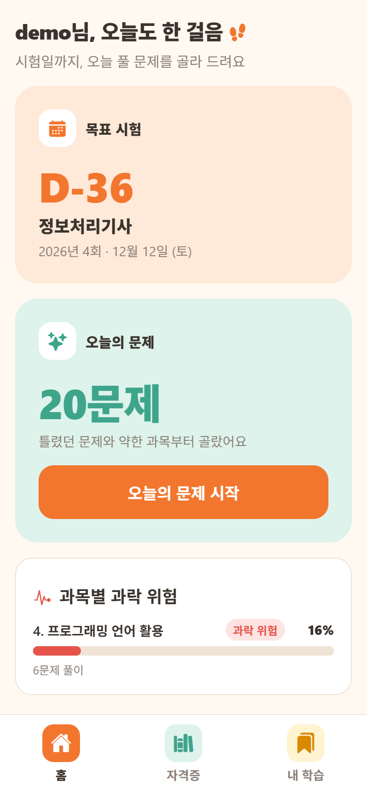
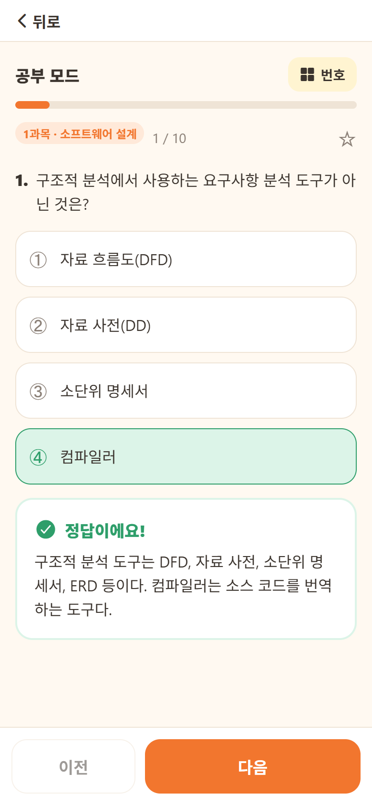
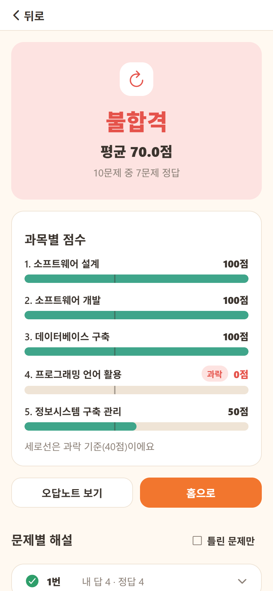
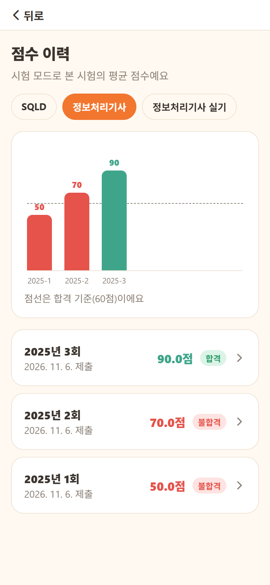
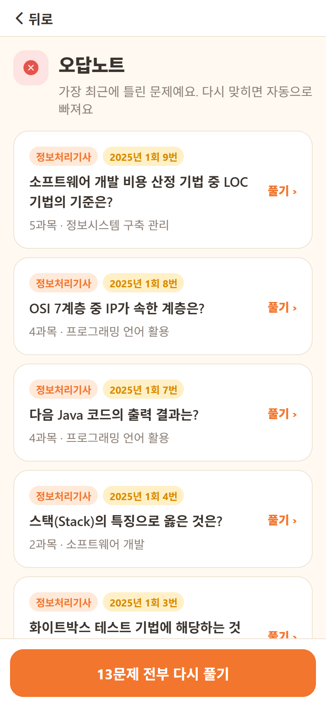
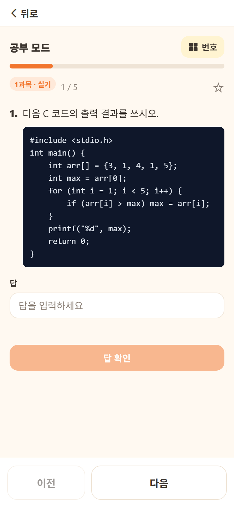
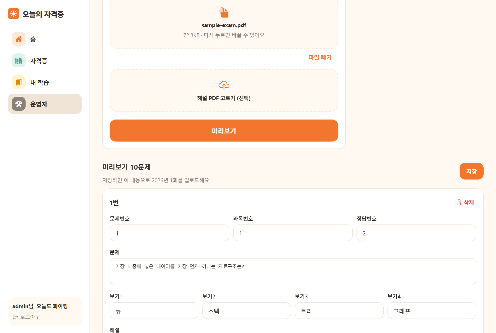

# 📅 오늘의 자격증 (Today Certificate)

> **시험일까지, 오늘 풀 문제를 골라주는 국가자격 필기 기출 학습 앱**

자격증 공부를 하면 "오늘은 뭘 풀어야 하지?"부터 고민하게 됩니다.
문제 은행은 많지만 문제만 쌓여 있을 뿐, 무엇을 풀지는 스스로 정해야 하죠.

**오늘의 자격증**은 시험일(D-day), 과목별 과락 위험, 내가 틀린 문제를 바탕으로
**오늘 풀 문제**를 골라 줍니다. 앱을 열면 바로 오늘의 공부를 시작할 수 있습니다.

## 🔗 바로 써 보기

| | 주소 |
|---|---|
| 웹 | **https://todaycertificate-client.vercel.app** |
| API 서버 | https://todaycertificate.onrender.com |
| 데모 계정 | 아이디 `Demouser` / 비밀번호 `Demouser123` (일반 회원) |

> - 서버가 Render 무료 플랜이라 한동안 요청이 없으면 잠듭니다. **첫 요청은 깨어나는 데 시간이 걸릴 수 있습니다.**
> - 데모 계정은 모두가 함께 쓰므로 풀이 기록과 오답노트가 섞여 있을 수 있습니다. 직접 가입해서 써도 됩니다.
> - 자격증과 문제는 개발용 샘플 데이터이며 실제 기출문제가 아닙니다.
> - 운영자 화면은 데이터 보호를 위해 계정을 공개하지 않습니다. [로컬 실행](#3-운영자-계정-선택)에서 직접 볼 수 있습니다.

2022년에 만든 Expo + Express + MySQL 앱을 **Spring Boot + PostgreSQL**로 다시 만들었습니다. (✅ 완료 · 🚧 진행 예정)

## 📱 화면

> 배포된 사이트를 데모 계정으로 캡처했습니다.

<table>
  <tr>
    <td align="center"><br><b>홈</b><br>D-day · 오늘의 문제 20개 · 과락 위험 과목</td>
    <td align="center"><br><b>공부 모드</b><br>고르면 바로 정답과 해설</td>
    <td align="center"><br><b>시험 결과</b><br>평균 70점이어도 <b>과락이면 불합격</b></td>
  </tr>
  <tr>
    <td align="center"><br><b>점수 이력</b><br>회차별 점수와 합격선</td>
    <td align="center"><br><b>오답노트</b><br>틀린 문제가 자동으로 모이고, 맞히면 빠짐</td>
    <td align="center"><br><b>실기 (단답형)</b><br>코드 줄바꿈·들여쓰기 그대로 표시</td>
  </tr>
</table>

**운영자: 기출 PDF 가져오기** (PDF를 읽어 문제·보기·정답을 표로 보여주고, 고친 뒤 저장)



---

## 이렇게 공부합니다

```
자격증 선택  →  회차 선택 (예: 2024년 1회)  →  공부 모드 / 시험 모드
                                                  ↓
                                 틀린 문제는 오답노트로, 중요한 문제는 별표로
                                                  ↓
                              다음 날, "오늘의 문제"가 약한 부분을 다시 골라줌
```

## 기능

### 👤 사용자
| 기능 | 설명 | 상태 |
|---|---|---|
| 회원가입·로그인 | BCrypt 비밀번호, JWT 토큰, USER/ADMIN 권한 | ✅ |
| 자격증 둘러보기 | 자격증 설명, 올해 시험 일정, 최근 기출 회차 목록 | ✅ |
| **공부 모드** | 한 문제씩 풀고 바로 정답과 해설 확인 | ✅ |
| **시험 모드** | 실제 시험과 같은 제한시간, 과목별 점수, **과락·합격 여부** 채점 | ✅ |
| 주관식(단답형) | 답을 직접 입력. 앞뒤·연속 공백과 대소문자 차이는 같은 답으로 보고, 복수 정답 허용 (코드 문제처럼 정확히 맞춰야 하는 문제는 예외) | ✅ |
| 시험 점수 이력 | 지난 시험 점수를 그래프와 목록으로 보기 (과락선 표시) | ✅ |
| 오답노트 | 틀린 문제가 자동으로 모이고, 다시 맞히면 빠짐 | ✅ |
| 별표 문제 | 다시 보고 싶은 문제 모아보기 | ✅ |
| 코드 문제 표시 | 프로그래밍 문제의 코드를 줄바꿈·들여쓰기 그대로 표시 | ✅ |
| ⭐ **오늘의 문제** | 오답 + 과락 위험 과목 + 안 푼 문제를 섞어 매일 약 20문제 추천 | ✅ |
| ⭐ **D-day** | 응시할 시험을 정하면 홈에 "정보처리기사 필기 D-23" | ✅ |
| ⭐ **과락 위험 리포트** | 과목별 정답률로 과락 위험 과목 알림 | ✅ |
| ⭐ 문제별 정답률 | "이 문제 정답률 42%, 많이 고른 오답은 3번" | ✅ |

### 🛠 운영자
| 기능 | 설명 | 상태 |
|---|---|---|
| 자격증 관리 | 설명, 과목, 시험 일정, 제한시간·과락·합격 기준 설정 | ✅ |
| 기출 CSV 업로드 | 회차별 문제를 CSV로 한 번에 등록. 오류가 있으면 줄별로 알려주고 전체를 저장하지 않음 | ✅ |
| 기출 PDF 가져오기 | 필기(객관식)·실기(주관식) PDF를 읽어 미리보기 → 수정 → 저장. 2단 편집 PDF, 코드 들여쓰기 유지 | ✅ |

## 기술 스택

| 영역 | 기술 | 선택 이유 |
|---|---|---|
| 서버 | Java 25, Spring Boot 4.1, Spring Data JPA | 국내 백엔드에서 가장 많이 쓰는 조합으로 다시 작성 |
| DB | PostgreSQL 17 (로컬은 Docker Compose) | 배포할 때 무료로 쓸 수 있는 호스팅이 많음 |
| 화면 | Expo (React Native), TypeScript | 하나의 코드로 웹과 앱을 모두 빌드할 수 있음. 웹으로 먼저 배포 |
| 인증 | Spring Security, JWT | 서버가 세션을 들고 있지 않아 웹·앱 어디서든 같은 방식으로 인증 |
| DB 마이그레이션 | Flyway | 스키마 변경을 SQL 파일로 기록해 로컬·테스트·배포 DB를 똑같이 맞춤 |
| 테스트 | JUnit, Testcontainers | H2 대신 실제 PostgreSQL로 테스트해 운영 DB와 차이로 생기는 버그를 막음 |
| CI | GitHub Actions | PR마다 서버 테스트와 화면 타입 검사를 자동 실행 |
| 배포 | Render (Docker), Neon, Vercel | 서버·DB·웹을 모두 무료 플랜으로 운영. 자세한 내용은 [배포](#배포) |

## 지금까지 된 것

- ✅ Express + MySQL 서버 제거 (DB 비밀번호와 `node_modules`가 커밋되어 있던 문제 정리)
- ✅ Spring Boot + JPA + PostgreSQL 서버, Flyway로 스키마 관리
- ✅ 기존 설계의 버그 수정: 해설 테이블이 문제와 연결되지 않아 모든 해설이 모든 문제 아래 표시되던 문제
- ✅ Expo 화면 새로 작성 (위 기능 목록의 ✅ 전부)
- ✅ 채점·과락·CSV/PDF 검증 테스트, GitHub Actions CI
- ✅ 배포: 서버(Render), DB(Neon), 웹(Vercel), 데모 계정
- 🚧 운영자 화면 데모 영상

## 로컬 실행

**필요한 것:** Java 25, Docker, Node.js 24

### 1. 서버

```bash
cd server
cp .env.example .env        # DB_PASSWORD, JWT_SECRET 값을 채운다
docker compose up -d        # PostgreSQL 실행
./gradlew bootRun           # http://localhost:8080 (테이블과 샘플 데이터가 자동으로 생성됨)
```

### 2. 화면

```bash
cd client
cp .env.example .env        # 서버 주소 (기본값 http://localhost:8080)
npm install
npm run web                 # http://localhost:8081
```

### 3. 운영자 계정 (선택)

회원가입하면 USER 권한입니다. 운영자 화면을 보려면 DB에서 권한을 바꾼 뒤 다시 로그인합니다.

```sql
UPDATE member SET role = 'ADMIN' WHERE login_id = '내 아이디';
```

CSV 업로드는 [`docs/sample/sample-questions.csv`](docs/sample/sample-questions.csv)로 해 볼 수 있습니다.

### 테스트

```bash
cd server && ./gradlew test         # Docker가 켜져 있어야 함 (Testcontainers)
cd client && npx tsc --noEmit       # 타입 검사
```

> 샘플 데이터(자격증·문제·일정)는 개발용으로 만든 것이며 실제 기출문제가 아닙니다.

## 배포

```
브라우저
   │  https://todaycertificate-client.vercel.app
   ▼
Vercel ── 화면(정적 파일) 응답: npx expo export -p web → dist/
   │
   │  /api/proxy/* 요청만 서버로 전달 (client/vercel.json rewrites)
   ▼
Render ── Spring Boot (Docker 컨테이너, server/Dockerfile)
   │      시작할 때 Flyway가 스키마와 샘플 데이터를 적용
   ▼
Neon ──── PostgreSQL
```

| 구성 | 서비스 | 설정 |
|---|---|---|
| 웹 | Vercel | Root `client`, Build `npx expo export -p web`, Output `dist`, 환경변수 `EXPO_PUBLIC_API_URL=/api/proxy` |
| 서버 | Render Web Service | Runtime **Docker**, Root `server`, 환경변수 `DB_URL`, `DB_USERNAME`, `DB_PASSWORD`, `JWT_SECRET` |
| DB | Neon | PostgreSQL. 접속 정보는 Render 환경변수에만 둠 |

### 이렇게 한 이유

- **Render에 Docker로 배포:** Render에는 Java 런타임이 없어서 Dockerfile로 빌드합니다.
  **멀티 스테이지 빌드**를 써서 JDK와 Gradle은 빌드 단계에만 쓰고, 실행 이미지에는 JRE와 jar만 남깁니다.
- **포트와 메모리:** Render가 알려주는 `PORT` 환경변수를 `-Dserver.port`로 넘깁니다.
  무료 인스턴스 메모리가 작아서 `-XX:MaxRAMPercentage=75`로 JVM 힙이 컨테이너 메모리를 넘지 않게 합니다.
- **CORS 대신 Vercel 프록시:** 화면은 `/api/proxy/...`처럼 자기 도메인으로 요청하고, Vercel이 Render로 전달합니다.
  브라우저 입장에서는 같은 도메인이라 CORS 설정이 필요 없고, 서버 주소는 `vercel.json` 한 곳에만 있습니다.
  대신 요청이 Vercel을 한 번 더 거칩니다.
- **SPA 경로 처리:** Expo 웹은 `index.html` 하나로 동작하는 SPA라서, `/login`처럼 하위 경로에서 새로고침해도
  `index.html`을 주도록 rewrites를 두었습니다.
- **비밀값 관리:** `.env`는 `.dockerignore`와 `.gitignore`로 막고, 운영 값은 Render 환경변수에만 둡니다.
  운영용 `JWT_SECRET`은 로컬과 다른 값을 씁니다.

### 배포하면서 겪은 문제

| 증상 | 원인 | 해결 |
|---|---|---|
| Render에서 서버 시작 실패 (`'url' must start with "jdbc"`) | Neon이 주는 `postgresql://user:pw@host/db` 주소를 그대로 넣음. 에러가 Bean 생성 실패로 연달아 나와 순환 참조처럼 보였음 | 로그의 마지막 원인을 따라가 확인. `jdbc:postgresql://host/db?sslmode=require`로 바꾸고 사용자·비밀번호는 따로 분리 |
| 화면이 서버 주소를 읽지 못함 (코드의 기본값 `localhost:8080`으로 요청하게 됨) | Next.js 규칙인 `NEXT_PUBLIC_` 이름으로 환경변수를 넣음 | Expo 규칙인 `EXPO_PUBLIC_API_URL`로 바꾸고 다시 빌드 (빌드할 때 코드에 박히는 값) |
| `/login`, `/api/proxy/*`가 404 | Vercel의 "Clone"으로 만든 복사본 레포에 연결되어, 원래 레포에 push한 `vercel.json`이 반영되지 않음 | 원래 레포를 Import해서 직접 연결 |

## 프로젝트 구조

```
server/   Spring Boot API 서버
client/   Expo 앱 (웹 우선)
docs/     완료 기준, API 문서, 설계 문서, 작업 계획
```

## 문서

- [완료 기준](docs/DONE.md)
- [API 문서](docs/API.md)
- [설계 문서](docs/superpowers/specs/2026-11-03-todaycertificate-design.md)
- [작업 계획](docs/superpowers/plans/2026-11-03-todaycertificate.md)
- [주관식 · 점수 이력 · PDF 가져오기 설계](docs/superpowers/specs/2026-11-03-short-answer-history-pdf-design.md)
